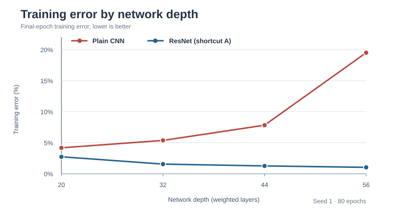
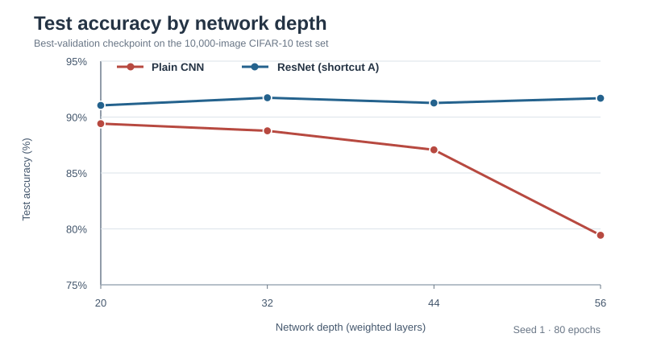

# ResNet depth study on CIFAR-10

I built this project to understand a question from the original ResNet paper: **why can a deeper plain CNN be harder to train, even though it has more layers?** Instead of relying on the paper's accuracy numbers, I trained my own CIFAR-10 models and checked the results.

I started with eight networks: plain CNNs and ResNets at depths 20, 32, 44 and 56. Each ran for 80 epochs under the same training setup. I later repeated the 56-layer pair with two more random seeds to see whether the result held up.

## What the runs showed

| Depth | Plain train error | ResNet train error | Plain test accuracy | ResNet test accuracy |
|---:|---:|---:|---:|---:|
| 20 | 4.187% | 2.740% | 89.41% | 91.04% |
| 32 | 5.380% | 1.556% | 88.77% | 91.73% |
| 44 | 7.836% | 1.264% | 87.07% | 91.26% |
| 56 | 19.518% | 1.036% | 79.43% | 91.68% |

The plain models got harder to fit as they became deeper, while the residual models kept their training error low. The clearest example was at 56 layers: both networks have **853,018 trainable parameters**, but Plain-56 finished with 19.518% training error against 1.036% for ResNet-56.

Those numbers are from seed 1. I also ran seeds 2 and 3 for the 56-layer models. Their three-seed average test accuracies were **81.57% (Plain-56)** and **91.67% (ResNet-56)**. The [repeat experiment](docs/depth56_seed_comparison.md) includes the individual results and standard deviations. The 20-, 32- and 44-layer models have not been repeated.

See the [full results](docs/results.md), [research report](docs/research_report.md), and [raw summary table](results/tables/depth_experiment_summary.csv).

## Results at a glance

The figures below use the measured seed-1 results, not expected paper values.





I kept the full training plots in the research archive. The two SVGs here make the main comparisons easier to see on GitHub.

## Implementation

- CIFAR ResNet with 20, 32, 44, or 56 weighted layers (the `6n + 2` layout).
- Three stages with 16, 32, and 64 channels.
- Plain and residual variants use the same convolutional layers. Residual option A adds parameter-free shortcuts.
- CIFAR-10 split: 45,000 training images, 5,000 validation images, and the untouched 10,000-image test set.
- SGD with momentum, batch size 128, 80 epochs, and learning-rate drops at epochs 40 and 60.
- Checkpoints, per-epoch CSV logs, and run configuration files saved for each model.

The [architecture notes](docs/architecture.md) describe the blocks and shortcuts in more detail. The 80-epoch schedule and some preprocessing choices differ from the original paper; this is a controlled comparison rather than an exact reproduction of its reported numbers.

## Running the project

Requires Python 3.10+ and PyTorch. A CUDA GPU is useful for the full experiment.

```bash
python -m venv .venv
source .venv/bin/activate
pip install -e ".[dev]"
python -m pytest -q
python scripts/prepare_data.py --root data
```

Check the eight planned runs first:

```bash
python scripts/run_experiment.py --experiment experiments/01_depth/experiment.yaml --dry-run
```

Train the experiment:

```bash
python scripts/run_experiment.py --experiment experiments/01_depth/experiment.yaml --device cuda
```

The runner skips runs that are already complete and resumes unfinished ones from `checkpoints/final.pt`. Results are saved in `results/runs/` by default. I used the [Colab notebook](notebooks/colab_train.ipynb) with Google Drive checkpoints for the original runs, and Kaggle for the later seed repeats.

To evaluate a run:

```bash
python scripts/evaluate.py --run results/runs/<run-directory> --device cuda
```

## Other analysis

I also checked layerwise gradient norms, model computation and timing, and common prediction mistakes. The gradient probe trained fresh models for five epochs; it was a separate diagnostic, not a trace of the full 80-epoch training runs.

I included configurations for shortcut types, BatchNorm, optimizer settings and augmentation in [`experiments/`](experiments/). I haven't run those full comparisons, so I have kept them separate from the finished results. See the [experiment guide](docs/experiments.md) and [limitations](docs/limitations.md).

## Project layout

```text
configs/        Model and training settings
src/            Architecture, data, training and analysis code
scripts/        Commands for training, evaluation and diagnostics
experiments/    Experiment definitions
notebooks/      Colab runner
tests/          Automated checks
docs/           Design notes and research write-up
results/        Published result tables
```

## References

- He, Zhang, Ren and Sun, *Deep Residual Learning for Image Recognition*, CVPR 2016.
- He, Zhang, Ren and Sun, *Identity Mappings in Deep Residual Networks*, ECCV 2016.
- Ioffe and Szegedy, *Batch Normalization*, ICML 2015.

MIT License.
